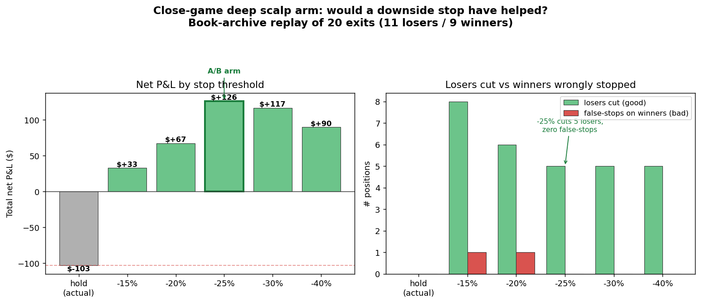

# Close-game scalp: the downside stop-loss A/B arm

**Question (2026-06-02):** the deep close-game scalp arm
(`agentic_closegame_scalp`, gated on the gemma3:27b deep forecast) was net
**−$—** over its first 20 exits. Would adding a downside stop-loss —
cutting a fading position to cash instead of riding it to a $0 resolution —
have made it profitable?

**Answer: yes, decisively. A −25% stop turns −$— into +$— with zero
false-stops on winners.** Wired up as an A/B arm; the number is in-sample, so
the arm runs forward to confirm it out-of-sample.



## Why it works — close-game losers bleed, they don't gap

The deep arm's 20 exits broke down as:

| Exit reason | n | Net P&L |
|---|---|---|
| `scalp_take_profit` | 5 | +$— |
| `resolution_won` | 4 | +$— |
| `resolution_lost` | 11 | **−$—** |
| **total** | **20** | **−$—** |

The damage is entirely in the 11 `resolution_lost` positions, each entered at
$0.35–$0.49 and held to a $0 settlement — a full ~$— stake lost every time.

The key empirical finding came from replaying each loser's **full post-entry
best-bid trajectory** out of `book_archive.sqlite`. A losing close game does
**not** gap straight to zero — it decays inning by inning, trading through
sellable bids the whole way down:

```
KXMLBGAME-26MAY302210AZSEA-AZ    entry 0.39 → min bid 0.01  (-97%)  1780 snaps
KXMLBGAME-26MAY311610AZSEA-AZ    entry 0.40 → min bid 0.14  (-65%)  1533 snaps
KXMLBGAME-26JUN011845MIAWSH-WSH  entry 0.49 → min bid 0.01  (-98%)   414 snaps
…all 11 losers reached a min bid of $0.01–$0.14 before resolving at $0
```

Because the price passes *through* every intermediate level, a stop placed at
`entry × (1 − stop_pct)` always finds a fill on the way down. It captures
~$0.25–0.40/share instead of riding to $0.

## Results by stop threshold

Replay applies the stop to **every** position (not just losers): the existing
+25% take-profit fires first, then the stop. Winners that dip below the stop
before recovering get **false-stopped** — that's the cost side of the ledger.

| Stop | Total net | Losers cut | $ salvaged vs hold | False-stops on winners | Cost of false-stops |
|---|---|---|---|---|---|
| hold (actual) | **−$—** | — | — | — | — |
| −15% | +$— | 8 | +$— | 1 | −$— |
| −20% | +$— | 6 | +$— | 1 | −$— |
| **−25%** | **+$—** | 5 | +$— | **0** | $0 |
| −30% | +$— | 5 | +$— | 0 | $0 |
| −40% | +$— | 5 | +$— | 0 | $0 |

**−25% is the sweet spot.** Tighter stops (−15/−20%) salvage more gross but
start clipping winners that dipped-then-recovered (the −$— false-stop cost).
At −25% and wider, zero winners are wrongly stopped while 5 losers are still
cut. −25% maximizes net.

## Implementation

`longshot_scalper.py`:

- `ScalpConfig.cg_stop_loss_pct: float | None` (default `None` = off).
- `evaluate_exit` precedence is now **take-profit → stop-loss → flip**. A stop
  cuts the position to cash with no re-entry (distinct from the flip, which
  sells *and* re-buys the opponent). In the close-game arm the flip is already
  disabled, so stop and TP are the only managed exits.
- Exit logged to `exits.jsonl` with `exit_reason="stop_loss"`.
- CLI: `--cg-stop-loss-pct 0.25`. `ScalpStats.stop_losses` counts fires.

The A/B arm (`~/.config/systemd/user/closegame-scalper-stop.service`) mirrors
the deep arm exactly — same `--forecast-source deep` gate — and adds
`--cg-stop-loss-pct 0.25`, writing to its own profile
`agentic_closegame_scalp_stop` for clean head-to-head P&L against the
hold-to-resolution `agentic_closegame_scalp`.

## Caveats (why this is an A/B arm, not a config change)

- **In-sample.** 9 winners / 11 losers. The −25% threshold is fit to this exact
  data; the forward arm is what validates it. The robust finding is the
  *mechanism* (close-game losers bleed through sellable bids), not the precise
  number.
- **Fill optimism.** Replay assumes a fill at the best bid in the cycle the
  stop crossed — realistic on these liquid MLB books, slightly optimistic on
  thin ones.
- **Consistent with "hold to resolution".** That standing rule is for
  *LLM-forecast value bets* held to settlement. This is a live in-game scalp
  whose thesis information-decays as the game plays out, so a stop is
  thesis-consistent here, not a contradiction.

## Reproducing

The replay walks `book_archive` best-bid snapshots from each position's entry
to resolution and tests stop thresholds against the recorded
`exits.jsonl`. Net P&L uses `kalshi_fees.round_trip_fees` (sports rate). All
inputs are in `data/agentic_closegame_scalp/exits.jsonl` +
`data/shared/book_archive.sqlite`.
